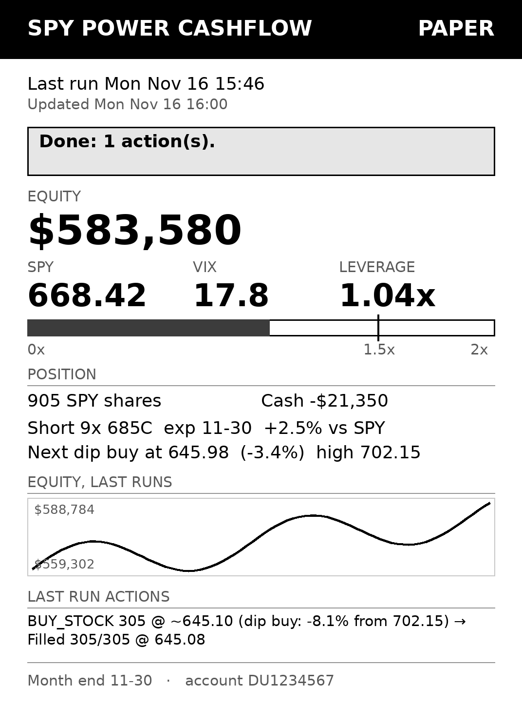

# Kindle Voyage dashboard



Every 15 minutes the Pi renders `state/status.json` and the trade journal into a 1072×1448 grayscale PNG and serves it on port 8080. The Kindle fetches the image over WiFi and draws it full screen with `eips`.

The dashboard shows:

- Mode (PAPER, DRY RUN or LIVE) and the last run's result. The result is shown inverted when something needs attention, or when there has been no run for 4 days.
- Equity, SPY, VIX, and leverage, with a gauge marking the 1.5x high-VIX limit.
- Shares, cash, and open calls with their distance from SPY.
- The next dip-buy price, an equity sparkline, the last run's orders, and the month-end date.

## Pi side

`deploy/setup_pi.sh` installs the units. Enable them with:

```bash
sudo systemctl enable --now pi-autotrader-dash.timer pi-autotrader-web.service
curl -sI http://localhost:8080/dashboard.png      # 200 OK
hostname -I                                        # the Pi's IP, for the Kindle
```

To preview the layout without any data, run `python -m autotrader.dashboard --demo`.

The image server is reachable by anything on your home network, and the picture shows account numbers. Don't forward port 8080 on the router. If you want the Pi's IP to stay fixed, give it a DHCP reservation in the router.

## Kindle side

The Kindle needs to be jailbroken first, with KUAL installed (WatchThis for firmware 5.13.6).

1. Edit `deploy/kindle/pidash/pidash.conf` and set `DASH_URL` to `http://<pi-ip>:8080/dashboard.png`.
2. Connect the Kindle over USB and copy the whole `deploy/kindle/pidash` folder to `extensions/pidash` on the Kindle drive.
3. Eject the Kindle, open **KUAL → Pi Dashboard → Start dashboard**.

The Kindle's own UI stops and the dashboard appears. It refreshes every `INTERVAL` seconds (default 900).

### Getting the normal Kindle back

With `STOP_UI=1`, KUAL stops along with the rest of the Kindle UI, so its **Stop dashboard** item can't be reached while the dashboard is up. To exit, tell the Kindle from the Pi:

```bash
echo stop > state/dash/kindle-control.txt   # within a minute the Kindle UI comes back
rm state/dash/kindle-control.txt            # clear it, or the next Start stops right away
```

If the Pi isn't reachable, hold the Kindle's power button for about 20 seconds to force a reboot. The dashboard doesn't auto-start, so it comes back as a normal Kindle.

With `STOP_UI=0` the Kindle UI keeps running and the KUAL menu items work, but the UI may now and then draw over the dashboard until the next refresh. **Refresh now** redraws once.

Keep the Kindle plugged in, ideally into one of the Pi's USB ports. The loop keeps WiFi on and the screensaver off, so the battery would run down in a few days otherwise.

If the screen shows `pidash: can't reach ...`, check the IP in `pidash.conf`, check that the Kindle is on the same WiFi, and run `systemctl status pi-autotrader-web` on the Pi.
